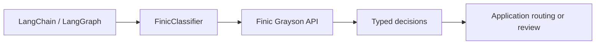

# langchain-finic

**Use Finic Grayson decision models in Python, LangChain, and LangGraph.**

[](https://pypi.org/project/langchain-finic/)
[](https://pypistats.org/packages/langchain-finic)
[](https://pypi.org/project/langchain-finic/)
[](https://github.com/supreplabs/langchain-finic/actions/workflows/ci.yml)
[](https://github.com/supreplabs/langchain-finic/blob/main/LICENSE)

[Documentation](https://supreplabs.github.io/langchain-finic/) ·
[Quickstart](#quickstart) · [Examples](#langchain-and-langgraph-examples) ·
[API reference](https://supreplabs.github.io/langchain-finic/api/) ·
[Releases](https://github.com/supreplabs/langchain-finic/releases)

`langchain-finic` is an open-source Python integration for the
[Finic Grayson API](https://docs.finic.ai/reference/decide). It brings typed,
probability-based decisions into LangChain Runnables, LangGraph workflows, and
agent tools. Use it to add risk assessment, review routing, or decision support
to an application, and to work with Finic custom scoring models.

Maintained by Suprep Labs, this is an independent alpha package; it is not endorsed
by Finic or LangChain.
See the [compatibility and support policy](https://supreplabs.github.io/langchain-finic/compatibility/)
for the public API, tested environments, and versioning commitments.

## What can you build?

- **Fraud and risk review:** ask Grayson structured questions about transaction
  or account evidence, then route cases according to your application's policy.
- **LangChain and LangGraph applications:** compose a classifier with LCEL, use
  it as a graph node, or expose decisions as an agent tool.
- **Agent workflows:** use optional middleware to route between host chat models
  or screen proposed tool calls.
- **Custom risk scoring:** score records with a Finic score model and manage
  model creation, calibration, and job status through the client or toolkit.

These are integration patterns, not claims of measured fraud detection accuracy.
Evaluate decisions on representative data before relying on them.

## Quickstart

Python 3.11 or newer and a Finic API key are required.

```bash
pip install langchain-finic==0.1.0a7
export FINIC_API_KEY=your_key
```

```python
from langchain_finic import DecisionRequest, FinicClassifier, Noul

request = DecisionRequest(
    data={"events": ["New device", "Payment to an unfamiliar recipient"]},
    questions={"takeover": Noul(instructions="Does the evidence suggest account takeover?")},
)
with FinicClassifier() as classifier:
    response = classifier.invoke(request)
    print(response.nouls["takeover"].noul)
```

The example sends fictional evidence to Finic and spends API credits. The result
is a model probability, not a verified fraud determination; your application
decides how to use it. The default model is `grayson-1`; set `FINIC_MODEL` to
change it. Applications are responsible for loading environment variables,
including values from `.env` files. See
[configuration and data handling](https://supreplabs.github.io/langchain-finic/usage/)
for client ownership, retries, and tracing.

## Capabilities

| Capability | Interface |
| --- | --- |
| Typed decisions | `Noul`, `Choice`, `MultiChoice`, `Score` |
| LCEL composition | `FinicClassifier` as a LangChain Runnable |
| Sync and async execution | `invoke`, `ainvoke`, `batch`, `abatch` |
| Agent tools | `classifier.as_tool()` with `create_agent` or `ToolNode` |
| Custom scoring | `FinicScorer`, `FinicToolkit`, and `FinicClient` |
| Optional middleware | `ModelRouterMiddleware` and `AutoModeMiddleware` |
| Host-enabled observability | LangSmith traces and usage metadata |

Batching makes individual API requests. Streaming yields one complete decision.
Use a host chat model for chat generation; tool screening remains probabilistic
and does not replace application authorization.

## How it fits



## LangChain and LangGraph examples

- [LCEL and LangGraph](https://github.com/supreplabs/langchain-finic/blob/main/examples/composition.py): compose a classifier and a typed graph node.
- [Finic decisions with LangChain](https://supreplabs.github.io/langchain-finic/tutorials/langchain-decisions/): use a decision in an LCEL chain.
- [LangGraph fraud review](https://supreplabs.github.io/langchain-finic/tutorials/langgraph-review/): route a fictional case through a graph.
- [Agent middleware](https://github.com/supreplabs/langchain-finic/blob/main/examples/middleware_agent.py): route between host chat models and screen tool calls.
- [Custom scoring](https://supreplabs.github.io/langchain-finic/scoring/): use a scorer as a Runnable or tool, and manage score model lifecycle operations.
- [System 1 evaluation](https://supreplabs.github.io/langchain-finic/evaluation/): reproduce a small synthetic evaluation of routing and tool screening, including its limitations.
- [Usage guide](https://supreplabs.github.io/langchain-finic/usage/): async calls, batching, agent tools, and configuration.

For middleware, install the extra and the provider packages for your host chat models:

```bash
pip install 'langchain-finic[middleware]==0.1.0a7'
```

## Frequently asked questions

### How do I use Finic Grayson with LangChain or LangGraph?

Install `langchain-finic`, set `FINIC_API_KEY`, and invoke `FinicClassifier`
with a typed `DecisionRequest`. The classifier is a LangChain Runnable, so it
can also be composed with LCEL, used in a LangGraph node, or exposed as an agent
tool. See the [composition example](https://github.com/supreplabs/langchain-finic/blob/main/examples/composition.py).

### Is Finic Grayson a chat model in this package?

No. The package exposes Finic's structured decision and scoring APIs, not a
LangChain chat model. Use a separate chat model when your application needs
generated text or an agent that reasons and calls tools.

### Does batching send a single request to Finic?

No. LangChain batch methods issue individual Finic API requests. Account for
request limits, latency, and API credits when choosing concurrency.

### Can I use this package for fraud detection or AML review?

It can integrate Grayson decisions and custom scores into fraud or AML review
workflows. The package does not provide a validated fraud or AML detection
system, and probabilistic output is not a substitute for authorization or
human review where required.

## Contributing

See [CONTRIBUTING.md](https://github.com/supreplabs/langchain-finic/blob/main/CONTRIBUTING.md) for setup, tests, and documentation standards.
Default tests run offline with mock providers. Report bugs through
[GitHub issues](https://github.com/supreplabs/langchain-finic/issues) and vulnerabilities
through [private security reporting](https://github.com/supreplabs/langchain-finic/blob/main/SECURITY.md).

Released under the [MIT license](https://github.com/supreplabs/langchain-finic/blob/main/LICENSE). See the [changelog](https://github.com/supreplabs/langchain-finic/blob/main/CHANGELOG.md) for version history.
