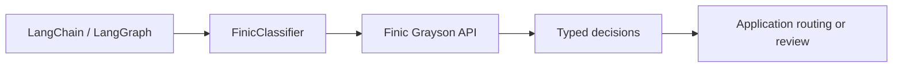

# langchain-finic

**Typed Finic Grayson decisions for LangChain and LangGraph.**

[](https://pypi.org/project/langchain-finic/)
[](https://pypistats.org/packages/langchain-finic)
[](https://pypi.org/project/langchain-finic/)
[](https://github.com/supreplabs/langchain-finic/actions/workflows/ci.yml)
[](LICENSE)

[Documentation](https://supreplabs.github.io/langchain-finic/) ·
[Quickstart](#quickstart) · [Examples](#examples) ·
[API reference](https://supreplabs.github.io/langchain-finic/api/) ·
[Releases](https://github.com/supreplabs/langchain-finic/releases)

Compose probability-based decisions with LCEL, expose them as agent tools, and use
middleware for model routing and tool screening.
An independent integration maintained by Suprep Labs.
This package is alpha and is not endorsed by Finic or LangChain.
See the [compatibility and support policy](https://supreplabs.github.io/langchain-finic/compatibility/)
for the public API, tested environments, and versioning commitments.

## Quickstart

Python 3.11 or newer and a Finic API key are required.

```bash
pip install langchain-finic==0.1.0a7
export FINIC_API_KEY=your_key
```

```python
from langchain_finic import DecisionRequest, FinicClassifier, Noul

request = DecisionRequest(
    data={"events": ["New device", "Payment to an unfamiliar recipient"]},
    questions={"takeover": Noul(instructions="Does the evidence suggest account takeover?")},
)
with FinicClassifier() as classifier:
    response = classifier.invoke(request)
    print(response.nouls["takeover"].noul)
```

The example sends fictional evidence to Finic and spends API credits. The default
model is `grayson-1`. See [configuration and data handling](https://supreplabs.github.io/langchain-finic/usage/)
for environment variables, client ownership, retries, and tracing.

## Capabilities

| Capability | Interface |
| --- | --- |
| Typed decisions | `Noul`, `Choice`, `MultiChoice`, `Score` |
| LCEL composition | `FinicClassifier` as a LangChain Runnable |
| Sync and async execution | `invoke`, `ainvoke`, `batch`, `abatch` |
| Agent tools | `classifier.as_tool()` with `create_agent` or `ToolNode` |
| Optional middleware | `ModelRouterMiddleware` and `AutoModeMiddleware` |
| Host-enabled observability | LangSmith traces and usage metadata |

Batching makes individual API requests. Streaming yields one complete decision.
Use a host chat model for chat generation; tool screening remains probabilistic
and does not replace application authorization.

## How it fits



## Examples

- [LCEL and LangGraph](examples/composition.py): compose a classifier and a typed graph node.
- [Agent middleware](examples/middleware_agent.py): route between host chat models and screen tool calls.
- [Usage guide](https://supreplabs.github.io/langchain-finic/usage/): async calls, batching, agent tools, and configuration.

For middleware, install the extra and the provider packages for your host chat models:

```bash
pip install 'langchain-finic[middleware]==0.1.0a7'
```

## Contributing

See [CONTRIBUTING.md](CONTRIBUTING.md) for setup, tests, and documentation standards.
Default tests run offline with mock providers. Report bugs through
[GitHub issues](https://github.com/supreplabs/langchain-finic/issues) and vulnerabilities
through [private security reporting](SECURITY.md).

Released under the [MIT license](LICENSE). See the [changelog](CHANGELOG.md) for version history.

Custom models are available through `FinicScorer` and `FinicToolkit`. See the
[custom scoring guide](docs/scoring.md) for native LangChain composition,
model lifecycle operations, retry behavior, and examples.
